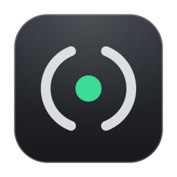
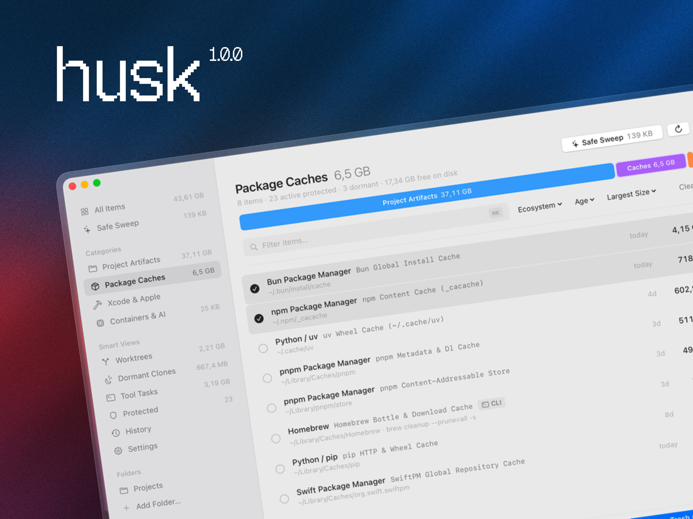
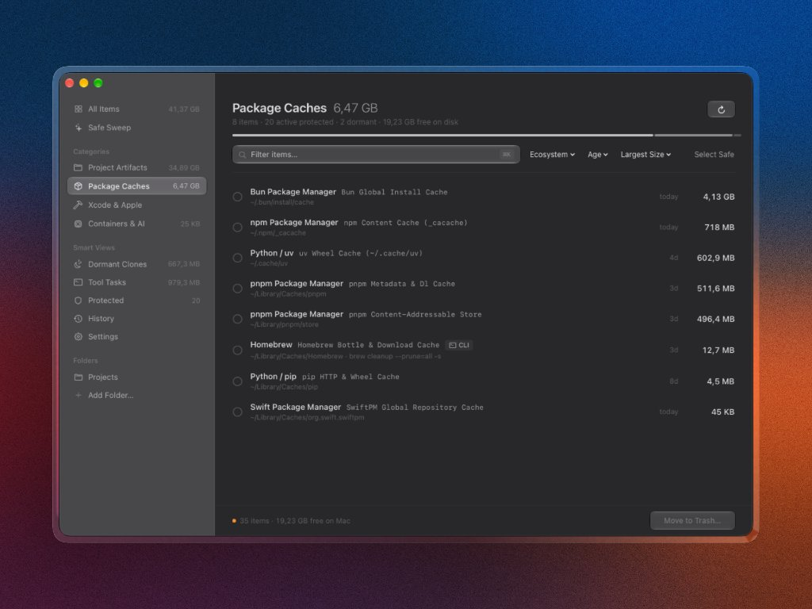

<div align="center">



# Husk

**Strip away heavy outer build husks — keep your source code untouched.**

A quiet, native macOS Liquid Glass developer disk & cache cleaner engineered for speed, clarity, and zero-regret safety.

<p>
  <a href="https://github.com/Piskaty/husk/releases/latest">
    
  </a>
  
  
  
</p>

<p>
  <a href="#install"><strong>Install</strong></a> ·
  <a href="#5-layer-safety-engine">Safety Engine</a> ·
  <a href="#what-husk-cleans">What It Cleans</a> ·
  <a href="#smart-views--features">Features</a> ·
  <a href="#keyboard-shortcuts">Shortcuts</a> ·
  <a href="CHANGELOG.md">Changelog</a>
</p>

<br />



</div>

---

## Why Husk?

Every macOS developer eventually loses 40–150 GB to forgotten `node_modules`, Rust `target/` folders, Swift `.build/` caches, Xcode `DerivedData`, global `bun`/`pnpm`/`npm`/`cargo`/`uv` stores, and bloated `.git/objects` packfiles.

**Husk** is a lightweight, native SwiftUI + AppKit utility built to reclaim that space calmly and safely:
- **True APFS Block Measurement**: Measures actual physical allocated disk blocks (`totalFileAllocatedSizeKey`) and deduplicates hard links (`pnpm`, `bun`) to estimate the size of cleanup targets.
- **Zero-Regret Safety**: Never deletes a folder named `target` or `build` unless its parent contains `Cargo.toml` / `build.gradle`, shields active or dirty Git repositories automatically, and moves items to **macOS Trash** with **1-Click Undo** by default.
- **Native Liquid Glass & Menu Bar**: Feels right at home on macOS with desktop-blending translucency, keyboard-first `⌘K` navigation, and a live Menu Bar disk monitor.

---

## Install

### Option 1 — One-Line Terminal Install (Recommended)

Installs the latest release directly to `/Applications/Husk.app` without browser Gatekeeper quarantine warnings:

```zsh
curl -fsSL https://raw.githubusercontent.com/Piskaty/husk/main/scripts/install.sh | zsh
```

> Run the same command anytime to update to the latest version, or use **Husk → Check for Updates…** inside the app.

### Option 2 — Manual Download from GitHub Releases

1. Download `Husk-<version>-macos-arm64.zip` from [**GitHub Releases**](https://github.com/Piskaty/husk/releases/latest).
2. Unzip and move **`Husk.app`** into **`/Applications`**.
3. Because Husk is an independent open-source app (ad-hoc signed without a paid Apple notarization certificate), macOS attaches a browser quarantine flag to direct downloads. Remove it once in Terminal:

```zsh
xattr -cr /Applications/Husk.app
```

Then open **Husk** from Applications or Spotlight.

---

## What Husk Cleans

| Category | Targets & Ecosystems | How It Restores |
| :--- | :--- | :--- |
| **Project Artifacts** | `node_modules`, `.next`, `.nuxt`, `.turbo`, `.vite`, `.parcel-cache`, `.svelte-kit`, `.angular`, Rust `target/`, Swift `.build/` & `.swiftpm/`, Python `.venv`, `venv`, `__pycache__`, `.pytest_cache`, `.mypy_cache`, `.ruff_cache`, Gradle `.gradle` & `build/` | Context-aware rebuild command inferred per lockfile (`bun install`, `pnpm install`, `cargo build`, `swift build`, `uv sync`, `./gradlew build`) |
| **Package Caches** | Bun (`~/.bun/install/cache`), pnpm store & cache, npm `_cacache`, Yarn, Cargo registry & git DB, Python `uv` & `pip`, Homebrew (`brew cleanup`), CocoaPods, SwiftPM | Re-downloaded automatically on demand |
| **Xcode & Apple** | `DerivedData` (expanded per project), `iOS DeviceSupport`, `watchOS DeviceSupport`, `CoreSimulator/Caches`, Unavailable Simulators (`xcrun simctl delete unavailable`), `Archives` (Tier 3 Protected) | Rebuilt by Xcode or re-copied on device connect |
| **Containers & AI** | HuggingFace Hub (expanded per model repo), Ollama local LLM blobs (Tier 3 Protected), PyTorch cache, Docker Buildx cache | Re-pulled via `ollama pull` / `huggingface_hub` |
| **Native CLI Tasks** | Bloated `.git/objects` packfiles (`git gc --prune=now`), dead iOS Simulators (`xcrun simctl delete unavailable`), Homebrew old bottles (`brew cleanup --prune=all -s`) | Non-destructive compaction & official tool pruning |

---

## 5-Layer Safety Engine

1. **Boundary & Symlink Guard**: Refuses to follow or delete symbolic links; hard-blocks `/System`, `/Library`, `/Applications`, `/usr`, `~/.ssh`, `~/Documents`, `~/Desktop`, and workspace roots themselves.
2. **Parent-Manifest Verification**: Folders named `target`, `build`, `.build`, or `node_modules` are only matched when paired with their sibling project manifest (`Cargo.toml`, `build.gradle`, `Package.swift`, `package.json`, `pyproject.toml`).
3. **Active-Project Shield**: Inspects the enclosing `.git` repository for recent commits/modifications (configurable, default `7 days`), uncommitted tracked changes (`git status --porcelain`), and active lockfiles. Active repos are badged **Active** and excluded from automatic selection.
4. **Regenerability Tiers**: Cleanly separates Tier 1 local rebuildable outputs, Tier 2 downloadable global caches, and Tier 3 protected items (active repos, Xcode `.xcarchive` dSYMs, local Ollama weights).
5. **Trash-First & Audit Trail with 1-Click Undo**: Moves cleaned items to macOS Trash by default, writes JSON + Markdown logs to `~/Library/Application Support/Husk/audit-logs/`, and lets you restore items that were moved to Trash. Direct tool tasks, including worktree removal, require separate confirmation.

---

## Smart Views & Features



- **1-Click Safe Sweep (`⇧⌘S`)**: Selects only Tier 1 rebuildable artifacts in clean repositories untouched for 30+ days and shows a pre-flight confirmation manifest before touching a single byte.
- **Dormant & Read-Only Clone Detector**: Inspects `.git/logs/HEAD` without spawning extra processes to surface repos you cloned once (`0` local commits) or left untouched for 120+ days.
- **Copy Rebuild Command & Session Script**: Hover any project row to copy its exact lockfile-aware rebuild command (`cd ~/Projects/app && bun install`), or copy a full re-bootstrap shell script from **History**.
- **Menu Bar & Low-Disk Monitor**: Displays live APFS free disk space and a quiet menu bar indicator when disk space runs low or dev husks cross your configured threshold.
- **Full Settings (`⌘,`) & Built-In Updater**: Configure safety windows, scan depth, excluded/pinned project folders (or right-click any row to exclude it), Launch at Login, and **Check for Updates…** via GitHub Releases or a custom HTTPS feed serving signed updates.
- **Changelog & What’s New**: Browse every release in the sidebar. On the first launch of a new version, Husk shows the changes since your previous version.

---

## Keyboard Shortcuts

| Shortcut | Action |
| :--- | :--- |
| `⌘K` | Open Command Palette |
| `⇧⌘S` | 1-Click Safe Sweep (Pre-Flight Preview) |
| `⇧⌘D` | Review & Move Selected to Trash |
| `⌘R` | Rescan Workspaces & Global Caches |
| `⇧⌘O` | Add Workspace Folder |
| `⇧⌘A` | Select All Unshielded in Current View |
| `⌘,` | Open Settings & Updates |

---

## Build from Source

Requires macOS 14+ (Apple Silicon) and Swift 6 / Xcode Command Line Tools.

```zsh
# Clone and run locally
git clone https://github.com/Piskaty/husk.git
cd husk
./scripts/build-app.sh --debug --run

# Run automated safety, scanner, and updater tests
swift test

# Build release artifacts (.app, .zip, .dmg, latest.json, SHA256SUMS.txt)
./scripts/package-release.sh --release
```

For a signed release, load the local release key and require a signature when packaging. GitHub Actions builds and tests the tag. Publish the resulting ZIP, ZIP signature, DMG (when available), `latest.json`, and `SHA256SUMS.txt` to the tagged GitHub Release. Use `dist/RELEASE_NOTES.md` for the release description.

```zsh
HUSK_UPDATE_SIGNING_KEY="$(< ~/.config/husk/update-signing-key)" \
HUSK_REQUIRE_UPDATE_SIGNATURE=1 ./scripts/package-release.sh --release
```
